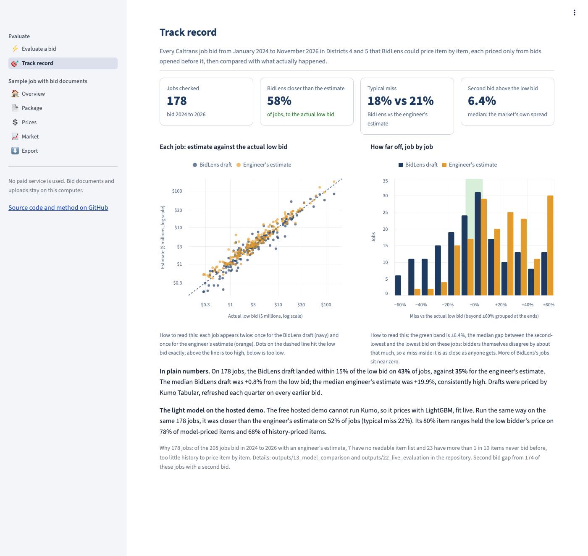
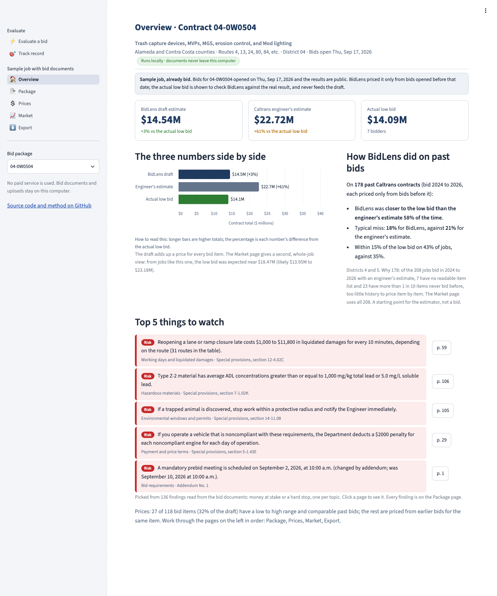
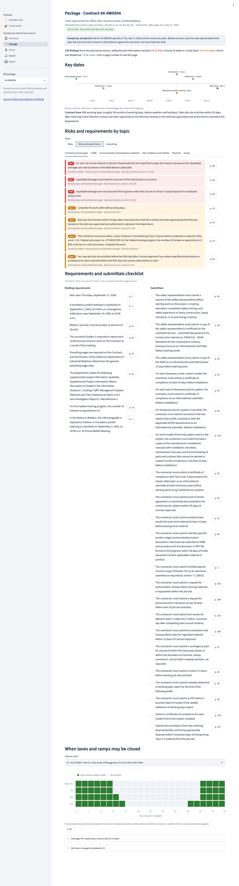
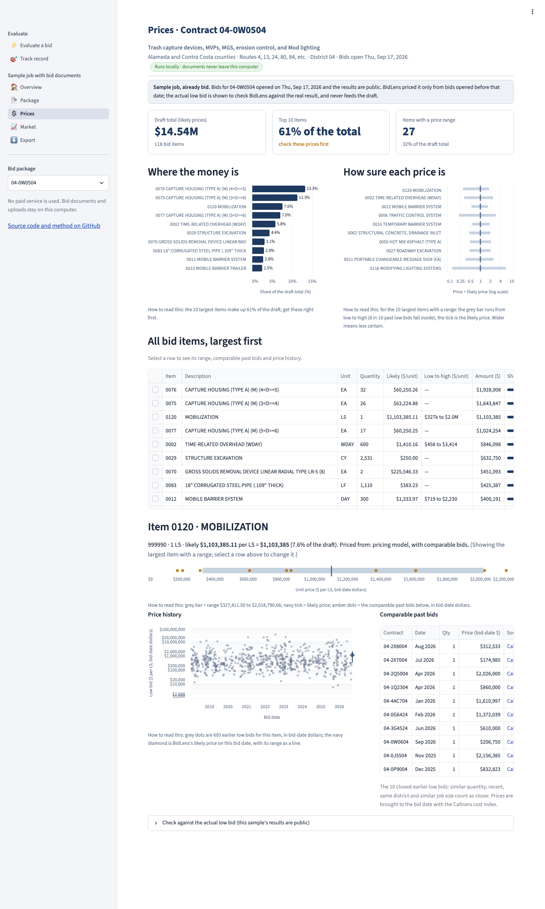
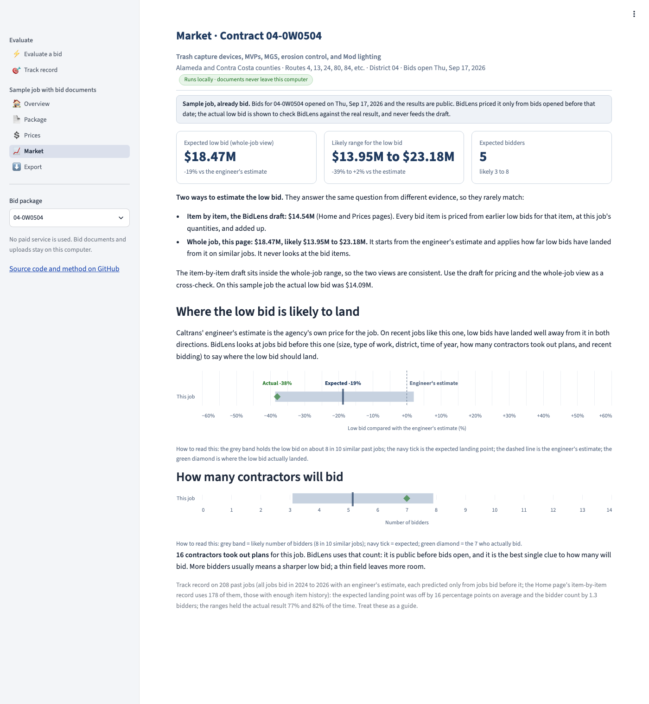
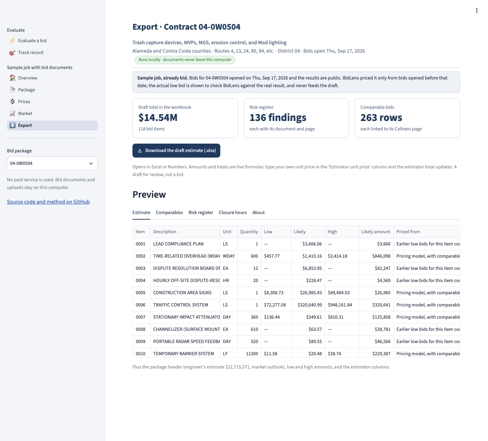
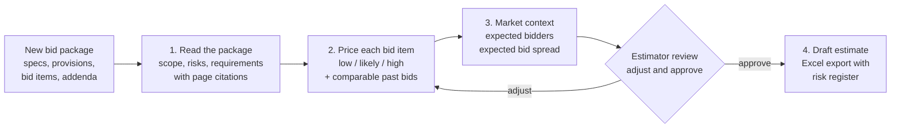
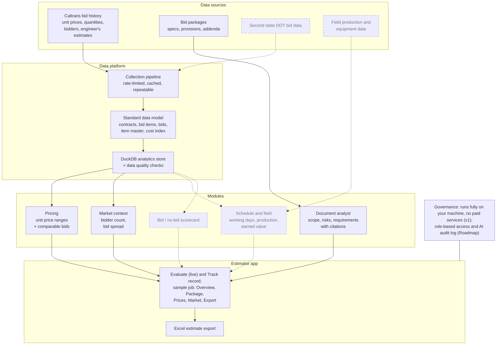

# BidLens

**An AI estimating copilot for heavy civil construction bids.**

BidLens helps an estimator move from "here is a new bid package" to "here is a defensible draft estimate" faster. It reads the bid documents, prices every bid item from years of real public bid results, shows what the market is likely to do, and exports a draft estimate the estimator can review and adjust.

> **Status: v1.0.0 is released, and the next version makes BidLens a live tool** ([what's new](CHANGELOG.md)): pick any Caltrans job bid in 2024 to 2026, or upload your own bid item list, and watch it priced step by step. [Try the live demo](https://huggingface.co/spaces/tanmaypathak4/bidlens) (no sign-in needed). Built and tested on public Caltrans data (Districts 4 and 5). Sections marked *Roadmap* are planned for after v1.
>
> **Headline:** on 178 Caltrans contracts bid in 2024 to 2026, which BidLens never saw while learning, its contract total landed closer to the winning bid than Caltrans' own engineer's estimate on **57.9%** of contracts (typical miss 18.4% against 21.2%). [Details below](#results).

---

## The problem, in plain terms

When a state transportation agency puts a highway, bridge or road project out to bid, contractors have a few weeks to answer three questions:

1. **What exactly are we being asked to build?** The answer is buried in hundreds of pages of specifications, special provisions and addenda.
2. **What should each piece of work cost?** A typical project has dozens to hundreds of priced line items: asphalt by the ton, concrete by the cubic yard, striping by the foot.
3. **Is this job worth chasing, and how hard will others compete?**

Most estimating teams answer these with experience, spreadsheets and past jobs they remember. That works, but it is slow, it depends on who is in the room, and it leaves a lot of useful history unused. Public agencies publish the results of every bid they open. That history shows what thousands of items actually sold for, where, when and against how many competitors.

BidLens puts that history, and the documents, to work for the estimator.

## What BidLens does

| You give it | It gives you |
| --- | --- |
| A bid package (specifications, special provisions, bid item list, addenda) | A plain summary of the scope, the risks and the requirements. Every point links to the page it came from. |
| The list of bid items and quantities | A low / likely / high unit price for each item, with the 10 most similar past bids behind each number |
| The project's location, size and type | The likely number of bidders, and how far the winning bid usually lands from the agency's own estimate |
| Your review and adjustments | A draft estimate in Excel, with live formulas and a risk register, ready for the estimating team |

BidLens does not replace the estimator. It does the reading and the lookup work, shows its evidence, and leaves the judgment to people who know how the work gets built.

**Try it: Evaluate a bid.** Pick a past Caltrans job or upload your own bid item list (CSV or Excel: item code, description, unit, quantity, and your unit prices if you have them). Press Evaluate and BidLens runs five steps for real, each showing its numbers and a chart as it finishes: load the items, price each item from every earlier Caltrans low bid, build the price ranges, the market view, and the risk summary from the bid documents. If your list has unit prices, **Check my bid** marks each one inside, above or below the BidLens range and ranks the items that move your total most.


*A live run on Caltrans contract 04-0W0504, which has already been bid. Priced only from bids opened before its quarter, the draft landed 4% above the actual low bid; the engineer's estimate was 61% above it. Because the job has been bid, the check runs on the actual low bidder's unit prices: 71 of them fell inside the BidLens range.*

<details>
<summary><b>The other pages</b>: track record, the sample job's documents, prices, market and export, and Evaluate on a phone</summary>

**Track record:** all 178 test jobs on one chart, BidLens and the engineer's estimate against the actual low bid, with the typical gap between the two lowest bids as a yardstick.



**Sample job with bid documents.** One job, 04-0W0504, also has its bid documents read, so these pages go deeper.

*Overview:* the draft, the engineer's estimate and the actual low bid side by side, and the top 5 things to watch, each linked to its page.



*Package:* scope, risks and requirements from the bid documents, each with its page. A summary that doesn't match its quote closely is replaced by the document's own words.



*Prices:* every bid item with its low / likely / high price, its price history and the comparable past bids behind it.



*Market:* a second, whole-job view of the low bid, side by side with the item-by-item draft, plus the expected number of bidders.



*Export:* a preview of the Excel workbook, then the download.



**On a phone:**


</details>

## Who it is for

- **Estimators and preconstruction teams:** faster first-pass pricing, with evidence attached.
- **Preconstruction leaders:** a consistent, data-backed view of each pursuit.
- **Project and operations teams (Roadmap):** schedule and production checks tied back to the estimate.

---

## How it works: the estimator's flow



1. **Read the package.** BidLens parses the bid documents and pulls out the scope of work and the risks: liquidated damages, night work, environmental work windows, traffic control and geotechnical conditions. It also lists requirements and submittals. Each item cites its page and section so it can be checked in seconds.
2. **Price each bid item.** For every item, BidLens estimates a unit price range, adjusted to today's dollars. It shows the past bids it learned from: which contract, when, where and at what quantity.
3. **Add market context.** For the project as a whole, it predicts how many contractors are likely to bid, and how the winning bid typically compares with the agency's engineer's estimate.
4. **Export a draft estimate.** The estimator reviews and adjusts, then exports an Excel workbook with live formulas and a risk register.

---

## Architecture

The full system has one data platform feeding a set of focused modules. Solid boxes are in v1; dashed boxes are on the Roadmap.



### The parts, briefly

- **Data platform.** Collects public bid history at a polite rate and caches everything so runs can be repeated. It cleans the data into one standard model and runs quality checks: missing values, impossible prices, duplicates and outliers.
- **Pricing.** Predicts unit prices by item, location, quantity and date, after adjusting history to bid-day dollars with Caltrans' own construction cost index. Two kinds of model were compared side by side on the same test: gradient-boosted trees (XGBoost, LightGBM) and NVIDIA Kumo Tabular, a pretrained model for tables. Kumo Tabular was chosen, on 2023 bids before the test years were looked at; no item family did well enough with another model to get an exception. Every price comes with a low / likely / high range and the 10 most similar past bids.
- **Refreshed every quarter.** The pricing models are refit each quarter on all earlier bids (a walk-forward setup), so they always learn from the latest market and never see the bids they are pricing. This was adopted after a check showed that models frozen at the end of 2023 drifted high in the test years (up to 24% over the low bid in 2026 for Kumo, 45% for XGBoost), because the statewide cost index rose much faster than these low bids.
- **Market context.** Learns from past bid openings how many bidders a project like this attracts, and how the winning bid usually compares with the engineer's estimate.
- **Document analyst.** Turns bid documents into structured, cited findings using an open-weight language model that runs on your own computer through [Ollama](https://ollama.com). Bid documents never leave the machine, and nothing is sent to a paid service. Every finding must quote the page it came from, and BidLens checks that the quote is really there.
- **Estimator app.** A simple web app that follows the estimator's own order of work and ends in an Excel export. Its Evaluate page prices any past Caltrans job or an uploaded bid item list live, from a compact bundle of public Caltrans low bids (about 1 MB, committed in `data/sample/engine/`). On a laptop the live run uses Kumo Tabular, in a separate process (about 15 to 30 seconds). The free hosted demo can't hold PyTorch, so it fits LightGBM live in a few seconds instead and says so on screen.

---

## How BidLens earns trust

Estimators are right to be skeptical of a number with no explanation. BidLens is built around that:

- **Every number shows its evidence.** Prices come with the past bids behind them. Extracted findings come with page and section references.
- **Honest testing.** Models learn from older bids and are tested only on newer ones, the same way they would be used in practice. Choices were made on 2023 bids, before the 2024 to 2026 test was looked at. Results are reported item family by item family, including where a model loses.
- **A real benchmark.** Each model is measured against the agency's engineer's estimate, not just against other models.
- **Runs locally, at no cost.** Everything, including the document reading, runs on your own computer with free, open models. Bid documents never leave the machine, and there is no subscription or API bill.
- **Market-level analysis.** The app looks at market behavior, not at individual contractors.

## Results

**Follow the work step by step:** the analysis is told in seven numbered [Jupyter notebooks](notebooks/README.md) that read directly on GitHub, from [01 Data overview](notebooks/01_data_overview.ipynb) to [07 Document extraction](notebooks/07_document_extraction.ipynb). Every stage also writes its results to a numbered folder in [`outputs/`](outputs/README.md), each with a plain-language README. No file names a bidder. What the models are for, and where they fall short, is in the [model card](docs/model_card.md).

**The test.** Everything below was measured on bids BidLens never saw while learning: models learn from bids opened before 2024 and are tested on bids opened from January 2024 to November 2026 (4,507 low-bid item prices on 238 contracts). Choices of method were made on 2023 bids, before the test was looked at.

### Whole contracts: BidLens against the engineer's estimate

For each test contract, BidLens prices every line of the bid list and adds them up. That total, Caltrans' engineer's estimate and the actual low bid are then compared. This is the estimator's real question: would BidLens have been a better guide to the winning number? ([notebook 05](notebooks/05_model_comparison.ipynb))

| On 178 test contracts | BidLens total | Engineer's estimate |
| --- | ---: | ---: |
| Closer to the low bid | **57.9%** of contracts | 42.1% |
| Typical miss (median distance from the low bid) | **18.4%** | 21.2% |
| Within 15% of the low bid | **43.3%** | 35.4% |
| Median over (+) or under (-) the low bid | **+0.8%** | +19.9% |

The engineer's estimate is a cost build-up, not a forecast of the low bid, and in 2024 to 2026 low bids in these districts came in well under it. A total built from earlier low bids benefits from that. On 42% of contracts the estimate was still closer.

### Single bid items

| Method (refreshed each quarter) | Median miss | Within 15% |
| --- | ---: | ---: |
| Historical median of the item's low bids (yardstick) | 55.0% | 15.3% |
| XGBoost | 40.1% | 20.9% |
| LightGBM | 38.9% | 20.9% |
| **NVIDIA Kumo Tabular (used by BidLens)** | **38.2%** | 20.8% |

A single item's low bid is noisy: on the same line, the second-lowest bidder's price differs from the low bidder's by a median of 27.5%, so no method should be expected to match single items closely. Lump sums are the hardest. Kumo was best in 11 of 18 item families; LightGBM or XGBoost won the other 7, by margins too small on 2023 bids to justify an exception. ([notebooks 03 to 05](notebooks/README.md))

**Ranges:** the low to high range held the actual low bid on **79.0%** of test prices (target 80%). Ranges are wide, typically 4x from low to high for items priced per unit and 13x for lump sums. Every price also lists its 10 most similar earlier bids, each linked to its Caltrans page.

**Speed and cost:** refreshing and pricing a quarter takes about 10 seconds with Kumo on a laptop processor; no GPU and no paid service.

### Market context

On 208 test contracts ([notebook 06](notebooks/06_market_context.ipynb)):

- **Where the low bid lands against the engineer's estimate:** typical miss **15.7 points** (a trailing median: 17.0). The 80% range held the actual result on 76.9% of contracts, but it is about 50 points wide: for one contract, the range is more useful than the middle number.
- **Number of bidders:** typical miss **1.3 bidders**, within one bidder on 63.5% of contracts. The plan-holder list Caltrans publishes carries much of this.

### Reading the bid documents

On a real Caltrans bid package (contract 04-0W0504, 6 PDFs), scored against 89 facts an estimator needs ([notebook 07](notebooks/07_document_extraction.ipynb)):

| Reader (all local, free) | Facts found | Findings correct | Citation supports the finding | Time on a 16 GB Mac |
| --- | ---: | ---: | ---: | ---: |
| qwen3:8b alone, first attempt | 55.1% | 69.7% | 80.6% | 59 min |
| **Default: qwen3:8b + llama3.1:8b + pattern rules** | **74.2%** | **76.9%** | 86.4% | 60 min |

The bid item list read from the documents matched Caltrans' bid summary exactly (118 items). The gold facts and the judging were done with an AI assistant, not a human estimator; a human review is still open.

### The live engine

The Evaluate page was checked the way it runs, on all 201 jobs bid in 2024 to 2026 with a full item list ([`outputs/22_live_evaluation`](outputs/22_live_evaluation/README.md)). With Kumo Tabular (on a laptop) it reproduces the contract totals above. With LightGBM, the light model on the free hosted demo, it was closer to the low bid than the engineer's estimate on 52% of the 178 headline jobs (typical miss 22%). Its 80% item ranges held the low bidder's price on 78% of model-priced items and 68% of items priced from earlier bids alone. For scale, the second-lowest bid was a median 6.4% above the low bid on these jobs.

### End to end on the sample package

For contract 04-0W0504 (trash capture, guardrail, erosion control and lighting; bid 17 September 2026), the BidLens draft total was **$14.54M**, **3% above** the actual low bid of $14.09M. The engineer's estimate, $22.72M, was 61% above it. The actual bids were used only for this check, never in the draft. The Evaluate page prices the job's item list from Caltrans' bid results summary (120 lines) rather than the package's own list (118 after the addenda), and refits the model live, so its draft is slightly different: $14.71M, 4% above the low bid.

---

## Data

| Source | What it provides | Use |
| --- | --- | --- |
| [Caltrans Contract Cost Data](https://sv08data.dot.ca.gov/) | Historical bid item prices, quantities and contracts | Pricing, market context |
| Caltrans bid summaries | Bidders, bid totals, engineer's estimates, working days | Market context |
| [Caltrans Standard Specifications and bid item codes](https://dot.ca.gov/programs/design/2026-ccs-standard-plans-and-standard-specifications) | Standard item list and specifications | Item master, document analyst |
| Caltrans Construction Cost Index | Price trend for major items | Adjusting history to today's dollars |
| Caltrans advertised projects | Real bid packages and addenda | Document analyst |

All data is public. The collection code follows each source's conditions of use and waits between requests. Bulk raw data is not committed to this repository. Included for the app, the demo and the tests: one prepared sample package and a compact bundle of every low bid and low bidder's item list (about 1 MB, public facts only, no bidder names).

v1 covers Caltrans Districts 4 and 5, bid years 2018 to 2026, and the 100 highest-value bid items.

---

## Getting started

Requirements: Python 3.11 or newer and [uv](https://docs.astral.sh/uv/). Everything is free and runs on your machine.

**Try the app in three commands.** It opens on Evaluate: pick any Caltrans job bid in 2024 to 2026, or upload your own bid item list (an example file is on the page), and press Evaluate. The included sample package (Caltrans contract 04-0W0504) also has its document findings, under "Sample job with bid documents":

```bash
git clone <repo-url> && cd bidlens
uv sync
uv run streamlit run app/Home.py
```

The sample is a small, prepared copy of one package (`data/sample/app/`, about 0.5 MB). The bid documents themselves are not in the repository, so the app shows each finding's quote and page reference but cannot display the page image until you download the package (below).

**Read the analysis without running anything:** the [notebooks](notebooks/README.md) display on GitHub with their charts. Notebooks 02 to 07 also rerun in seconds on a fresh clone, because they read the results saved in `outputs/`.

**Run the tests:**

```bash
make test
```

### Going further: rebuilding from the public sources

These steps rebuild everything the sample was made from. They take longer, and two of them need files downloaded by hand.

1. **Bid history.** Download the Caltrans bid summary PDFs by hand into `data/raw/bid_summaries/`, one PDF per contract, named by contract number (for example `04-0A0204.pdf`). The contracts and their Caltrans source pages are listed in [`outputs/03_bid_summaries/pdf_manifest.csv`](outputs/03_bid_summaries/pdf_manifest.csv). Then `make data` collects item prices from the Caltrans cost database (deliberately slow: one request every 2 seconds, about 2 hours the first time, cached afterwards) and builds the database.
2. **Pricing models.** `make pricing` (about 12 minutes) fits and scores every model. The first run downloads NVIDIA Kumo Tabular's small model (about 114 MB) from Hugging Face.
3. **A bid package.** Download contract 04-0W0504's documents by hand into `data/raw/bid_package/04-0W0504/`, keeping the original file names. The files are listed, with their sizes and checksums, in [`outputs/16_bid_package/manifest.csv`](outputs/16_bid_package/manifest.csv). Install [Ollama](https://ollama.com) and the two local models once (about 10 GB in all; a Mac with 16 GB of memory runs them):

   ```bash
   ollama pull qwen3:8b
   ```

   ```bash
   ollama pull llama3.1:8b
   ```

   Then parse the package, rebuild its closure charts and read it (about an hour; the two models run one after the other):

   ```bash
   uv run python -m bidlens.documents.parse 04-0W0504
   ```

   ```bash
   uv run python -m bidlens.documents.charts 04-0W0504
   ```

   ```bash
   uv run python -m bidlens.documents.extract 04-0W0504 --mode combined
   ```

4. **The draft estimate.** `uv run python -m bidlens.estimate 04-0W0504` (a few seconds), then start the app as above. The app uses what you built, and falls back to the sample otherwise.

Lint with `make lint`.

**Optional: hosted model.** BidLens never needs a paid service. If you have your own Anthropic API key and prefer a hosted model for document reading, set `ANTHROPIC_API_KEY` and run the extraction with `--mode hosted`. This is off by default; it sends the relevant document passages to the Claude API and is billed to your key.

## Project structure

```
src/bidlens/
  ingest/      data collection
  db/          data model, loading, quality checks
  pricing/     price escalation, models, comparison, ranges, comparable bids
  market/      bidder count and bid spread models
  documents/   document parsing, closure charts, extraction, evaluation
  analysis/    tables and charts for the notebooks
  live/        the live engine behind the Evaluate page, its data bundle and its check
  estimate.py  the draft estimate for one bid package
  export.py    Excel estimate export
  sample.py    the small sample package the app ships with
app/           Streamlit estimator app
notebooks/     the analysis, step by step
outputs/       every stage's results, numbered, each with a README
data/sample/   the committed sample package and the live engine's bundle (all other data is rebuilt, not committed)
docs/          data dictionary, model card
tests/
```

---

## Roadmap

- **Bid / no-bid scorecard:** combines competition, expected spread, work-type fit and schedule pressure into one score with its reasons.
- **Schedule and field:** a working-days model with schedule risk flags, field production and equipment data, and an earned value view that feeds production rates back into future estimates.
- **More data:** a second state's DOT bid data, and NVIDIA Kumo Relational, which learns across linked contract, item, bid and bidder tables.
- **Documents:** addendum change detection, and checks of document quantities against the bid item list.
- **Map:** prices and competition by district.
- **Platform:** role-based access, an audit log of AI outputs, a REST API, scheduled pipelines, and exports to scheduling tools.

## Limitations

- v1 uses public Caltrans data for two districts. Prices for other regions, or for private work, will differ.
- Historical prices reflect past market conditions. Escalation adjusts for broad trends, not for local shocks such as material shortages.
- Single item prices miss the low bid by a median of 38%, and ranges are wide. Contract totals are much closer, because over- and under-priced lines partly cancel. Lump sums and unusual quantities are the least reliable.
- The comparison with the engineer's estimate covers 2024 to 2026, when low bids in these districts ran well under Caltrans' estimates. In a different market the margin may shrink.
- Items that are not among the 100 modeled items are priced from the median of earlier low bids for the same item. They get a range only when there are at least 5 earlier bids (the 10th to 90th percentile), and those ranges held the low bid less often than the model's (68% against 78%).
- For an uploaded list, give the engineer's estimate if you have it: lump-sum items such as mobilization depend on the size of the job, and without it BidLens can only guess the size from the list.
- The free hosted demo prices with LightGBM, not Kumo Tabular, and is less accurate (see Results).
- Document extraction is an aid to review, not a substitute for reading the contract.
- On a test package, the document reader (two local models plus plain pattern rules) finds about three quarters of the facts an estimator needs, and about 1 in 4 of its findings needs correcting. Read the cited page before relying on a finding. Lane closure hour charts are read by plain code from the page layout, not by the model.
- BidLens supports estimating judgment. It does not replace it.

## How this project was built

BidLens is a working prototype built on public Caltrans data. Every number can be traced: each stage's collected data, checks and results are in [`outputs/`](outputs/README.md), and the analysis is explained step by step in [`notebooks/`](notebooks/README.md). Models were always tested on bids they had never seen, and the results report where BidLens works well and where it doesn't.

## License

The code is released under the MIT License. See `LICENSE`. Caltrans bid data and bid documents are public records and are not covered by this license.
