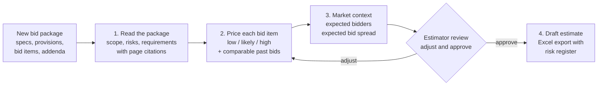
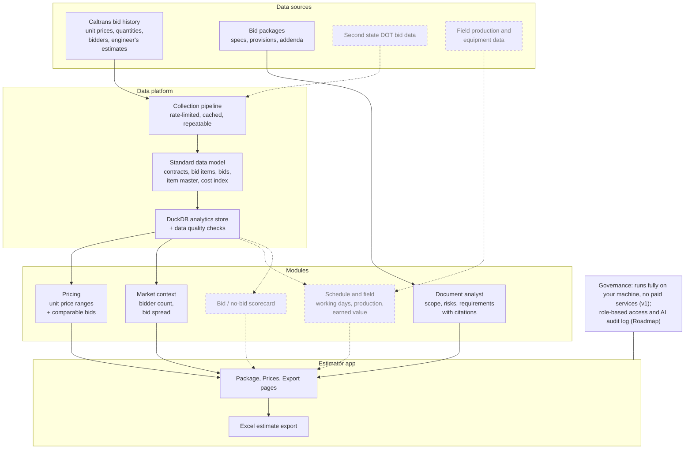

# BidLens

**An AI estimating copilot for heavy civil construction bids.**

BidLens helps an estimator move from "here is a new bid package" to "here is a defensible draft estimate" faster. It reads the bid documents, prices every bid item from years of real public bid results, shows what the market is likely to do, and exports a draft estimate the estimator can review and adjust.

> Status: v1 in development. This README describes the full product. Sections marked *Roadmap* are planned for after v1.

---

## The problem, in plain terms

When a state transportation agency puts a highway, bridge or road project out to bid, contractors have a few weeks to answer three questions:

1. **What exactly are we being asked to build?** The answer is buried in hundreds of pages of specifications, special provisions and addenda.
2. **What should each piece of work cost?** A typical project has dozens to hundreds of priced line items: asphalt by the ton, concrete by the cubic yard, striping by the foot.
3. **Is this job worth chasing, and how hard will others compete?**

Most estimating teams answer these with experience, spreadsheets and past jobs they remember. That works, but it is slow, it depends on who is in the room, and it leaves a lot of useful history unused. Public agencies publish the results of every bid they open. That history shows what thousands of items actually sold for, where, when and against how many competitors.

BidLens puts that history, and the documents, to work for the estimator.

## What BidLens does

| You give it | It gives you |
| --- | --- |
| A bid package (specifications, special provisions, bid item list, addenda) | A plain summary of the scope, the risks and the requirements. Every point links to the page it came from. |
| The list of bid items and quantities | A low / likely / high unit price for each item, with the 10 most similar past bids behind each number |
| The project's location, size and type | The likely number of bidders, and how far the winning bid usually lands from the agency's own estimate |
| Your review and adjustments | A draft estimate in Excel, with live formulas and a risk register, ready for the estimating team |

BidLens does not replace the estimator. It does the reading and the lookup work, shows its evidence, and leaves the judgment to people who know how the work gets built.

## Who it is for

- **Estimators and preconstruction teams:** faster first-pass pricing, with evidence attached.
- **Preconstruction leaders:** a consistent, data-backed view of each pursuit.
- **Project and operations teams (Roadmap):** schedule and production checks tied back to the estimate.

---

## How it works: the estimator's flow



1. **Read the package.** BidLens parses the bid documents and pulls out the scope of work and the risks: liquidated damages, night work, environmental work windows, traffic control and geotechnical conditions. It also lists requirements and submittals. Each item cites its page and section so it can be checked in seconds.
2. **Price each bid item.** For every item, BidLens estimates a unit price range, adjusted to today's dollars. It shows the past bids it learned from: which contract, when, where and at what quantity.
3. **Add market context.** For the project as a whole, it predicts how many contractors are likely to bid, and how the winning bid typically compares with the agency's engineer's estimate.
4. **Export a draft estimate.** The estimator reviews and adjusts, then exports an Excel workbook with live formulas and a risk register.

---

## Architecture

The full system has one data platform feeding a set of focused modules. Solid boxes are in v1; dashed boxes are on the Roadmap.



### The parts, briefly

- **Data platform.** Collects public bid history at a polite rate and caches everything so runs can be repeated. It cleans the data into one standard model and runs quality checks: missing values, impossible prices, duplicates and outliers.
- **Pricing.** Predicts unit prices by item, location, quantity and date, after adjusting history to today's dollars with the Caltrans Construction Cost Index. Two kinds of model are compared side by side on the same test: gradient-boosted trees (XGBoost, LightGBM) and NVIDIA Kumo Tabular, a foundation model for tables. The agency's own engineer's estimate is the benchmark both must beat. The best model is chosen per item family, based on the results.
- **Market context.** Learns from past bid openings how many bidders a project like this attracts, and how the winning bid usually compares with the engineer's estimate.
- **Document analyst.** Turns bid documents into structured, cited findings using an open-weight language model that runs on your own computer through [Ollama](https://ollama.com). Bid documents never leave the machine, and nothing is sent to a paid service. Every finding must quote the page it came from, and BidLens checks that the quote is really there.
- **Estimator app.** A simple web app that follows the estimator's own order of work and ends in an Excel export.

---

## How BidLens earns trust

Estimators are right to be skeptical of a number with no explanation. BidLens is built around that:

- **Every number shows its evidence.** Prices come with the past bids behind them. Extracted findings come with page and section references.
- **Honest testing.** Models are trained on older bids and tested only on newer ones, the same way they would be used in practice. Results are reported item family by item family, including where a model loses.
- **A real benchmark.** Each model is measured against the agency's engineer's estimate, not just against other models.
- **Runs locally, at no cost.** Everything, including the document reading, runs on your own computer with free, open models. Bid documents never leave the machine, and there is no subscription or API bill.
- **Market-level analysis.** The app looks at market behavior, not at individual contractors.

## Results

**Follow the work step by step:** the analysis is told in numbered [Jupyter notebooks](notebooks/README.md) that read directly on GitHub, starting with [01 Data overview](notebooks/01_data_overview.ipynb). Every stage also writes its results to a numbered folder in [`outputs/`](outputs/README.md), from the source review and the 72,113 collected bid prices to the cross-checks and data quality reports. Each folder has a plain-language README. No file names a bidder.

Evaluation results will be published here and in `outputs/` as v1 is completed:

- **Pricing accuracy** by item family: median error, and the share of items within 15% of the winning unit price, against the engineer's estimate.
- **Model comparison:** XGBoost, LightGBM and NVIDIA Kumo Tabular, covering accuracy, speed and license.
- **Market context accuracy:** bidder count and bid spread.
- **Document extraction quality:** precision, recall and citation accuracy on a hand-labeled bid package.

---

## Data

| Source | What it provides | Use |
| --- | --- | --- |
| [Caltrans Contract Cost Data](https://sv08data.dot.ca.gov/) | Historical bid item prices, quantities and contracts | Pricing, market context |
| Caltrans bid summaries | Bidders, bid totals, engineer's estimates, working days | Market context |
| [Caltrans Standard Specifications and bid item codes](https://dot.ca.gov/programs/design/2026-ccs-standard-plans-and-standard-specifications) | Standard item list and specifications | Item master, document analyst |
| Caltrans Construction Cost Index | Price trend for major items | Adjusting history to today's dollars |
| Caltrans advertised projects | Real bid packages and addenda | Document analyst |

All data is public. The collection code follows each source's conditions of use and waits between requests. Bulk raw data is not committed to this repository; only a small sample is included for the demo and tests.

v1 covers Caltrans Districts 4 and 5, bid years 2018 to 2026, and the 100 highest-value bid items.

---

## Getting started

Requirements: Python 3.11 or newer, [uv](https://docs.astral.sh/uv/), and, for reading bid documents, [Ollama](https://ollama.com) with one local model (about 5 GB; a Mac with 16 GB of memory runs it). Everything is free and runs on your machine.

```bash
git clone <repo-url> && cd bidlens
uv sync
uv run streamlit run app/Home.py
```

To read bid documents, install Ollama and download the two models once (about 10 GB in all):

```bash
ollama pull qwen3:8b
```

```bash
ollama pull llama3.1:8b
```

Then read a bid package (about an hour on a Mac with 16 GB; the two models run one after the other):

```bash
uv run python -m bidlens.documents.extract 04-0W0504 --mode combined
```

The app runs on the included sample data. To rebuild the full dataset from the public sources, run `make data`. This takes a while, because requests are deliberately rate-limited.

Other commands:

```bash
make test    # run the test suite
make lint    # lint with ruff
```

**Optional: hosted model.** BidLens never needs a paid service. If you have your own Anthropic API key and prefer a hosted model for document reading, set `ANTHROPIC_API_KEY` and run the extraction with `--mode hosted`. This is off by default; it sends the relevant document passages to the Claude API and is billed to your key.

## Project structure

```
src/bidlens/
  ingest/      data collection
  db/          data model, loading, quality checks
  pricing/     price escalation, models, comparison, comparable bids
  market/      bidder count and bid spread models
  documents/   document parsing, extraction, evaluation
  export/      Excel estimate export
app/           Streamlit estimator app
docs/          build plan, data dictionary, model card, results
tests/
```

---

## Roadmap

- **Bid / no-bid scorecard:** combines competition, expected spread, work-type fit and schedule pressure into one score with its reasons.
- **Schedule and field:** a working-days model with schedule risk flags, field production and equipment data, and an earned value view that feeds production rates back into future estimates.
- **More data:** a second state's DOT bid data, and NVIDIA Kumo Relational, which learns across linked contract, item, bid and bidder tables.
- **Documents:** addendum change detection, and checks of document quantities against the bid item list.
- **Map:** prices and competition by district.
- **Platform:** role-based access, an audit log of AI outputs, a REST API, scheduled pipelines, and exports to scheduling tools.

## Limitations

- v1 uses public Caltrans data for two districts. Prices for other regions, or for private work, will differ.
- Historical prices reflect past market conditions. Escalation adjusts for broad trends, not for local shocks such as material shortages.
- Document extraction is an aid to review, not a substitute for reading the contract.
- On a test package, the document reader (two local models plus plain pattern rules) finds about three quarters of the facts an estimator needs, and about 1 in 4 of its findings needs correcting. Read the cited page before relying on a finding. Lane closure hour charts are read by plain code from the page layout, not by the model.
- BidLens supports estimating judgment. It does not replace it.

## How this project is built

Development follows `the build notes`. Every technical decision, with the options considered and the reasoning, is recorded in the Decision log in `the project notes`, so the history of why the project looks the way it does stays in the repository.

## License

The code is released under the MIT License. See `LICENSE`. Caltrans bid data and bid documents are public records and are not covered by this license.
