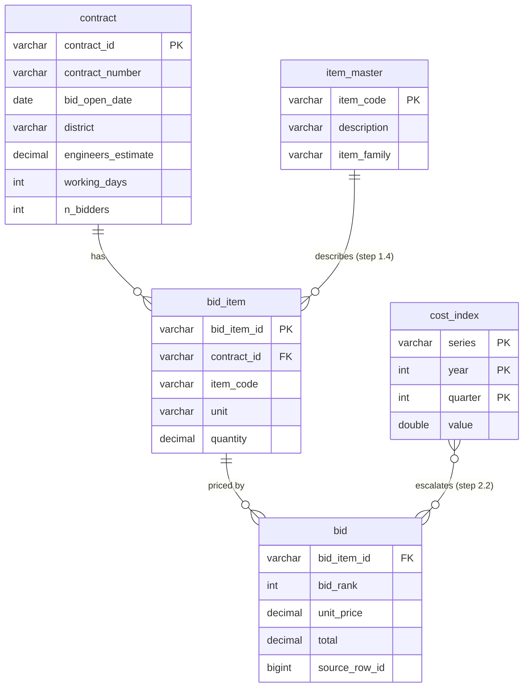

# Data dictionary

BidLens keeps its data in one DuckDB file, `data/bidlens.duckdb`, which is rebuilt from the cached sources. Keys are set by decision D-023 and price storage by D-024. The schema is in `src/bidlens/db/schema.sql`.

## contract

One row per **bid opening**. A contract that was re-advertised has one row for each opening.

| Column | Meaning | Source |
| --- | --- | --- |
| contract_id | `<contract number>_<bid open date>`, e.g. `04-1Q7004_2025-01-07` | derived |
| contract_number | Caltrans contract number (EA) | sv08data |
| bid_open_date | Date bids were opened | sv08data / bid summary |
| district | Caltrans district, taken from the first two digits of the contract number | derived |
| county, location | County code and County-Route-Postmile as published | sv08data `details.php` |
| type_of_work | Contract description | sv08data `details.php` |
| in_contract_list | Found by the D-015 contract list | derived |
| n_bidders_sv08 | Highest bid rank seen in the item bids | sv08data |
| has_bid_summary | A usable bid summary PDF exists (D-022) | bid summary |
| engineers_estimate | Agency's pre-bid estimate for the whole contract ($) | bid summary |
| working_days | Contract time allowed | bid summary |
| n_bidders | Ranked (regular) bidders | bid summary |
| n_bidders_reported | Bidders as printed; may include irregular bids | bid summary |
| low_bid_cost, low_bid_total | Low bid. For A+B contracts, the total adds time × daily rate | bid summary |
| second_bid_total | Second-ranked bid total | bid summary |
| is_a_plus_b | Bid on cost plus time | bid summary |
| project_id, n_items, proposals_issued | As printed | bid summary |

## bid_item

One priced line of a contract opening.

| Column | Meaning |
| --- | --- |
| bid_item_id | `<contract_id>_<item code>_<n>`. `n` numbers repeated codes within an opening |
| item_code | Caltrans item code as published |
| item_description | As published |
| unit | Original Caltrans unit (never converted here) |
| quantity | Engineer's estimated quantity. Lump-sum items are 1 |

## bid

One bidder's price for one bid item. **No bidder names or IDs are stored.**

| Column | Meaning |
| --- | --- |
| bid_rank | The bidder's overall rank on the contract (1 = low bidder), not their rank on this item |
| unit_price | Price per unit in the original unit ($) |
| total | unit_price × quantity ($) |
| source_row_id | sv08data row number. `https://sv08data.dot.ca.gov/details.php?Num=<id>` shows the source |

## item_master and cost_index

These are created empty here. Step 1.4 fills the item master (current item list, unit normalization, item families) and step 2.2 fills the cost index (Caltrans Construction Cost Index).

**cost_index (step 2.2, D-039, D-040, D-044).** Two series, keyed by (series, year, quarter):

| Series | What it holds |
| --- | --- |
| `CHCCI_2020` | Caltrans highway construction cost index, 2020 = 100, one value per published quarter. Recovered from the adjusted prices on the cached sv08data result pages |
| `CHCCI_2020_KNOWN` | The index as known before each quarter's bids open: the mean of `CHCCI_2020` over the 4 previous quarters (D-044). Used for escalation. Quarters not yet published carry forward the last value |

**bid_escalated (view).** Every column of `bid_normalized` plus `bid_open_date`, `cost_index` (the bid quarter's `CHCCI_2020_KNOWN` value), `ref_year`, `ref_quarter`, `ref_index` (the latest quarter in the series) and `unit_price_escalated` = unit_price × ref_index / cost_index, the price in reference-quarter dollars. Models escalate to each bid's own date instead, through `bidlens.pricing.setup.escalate`.
