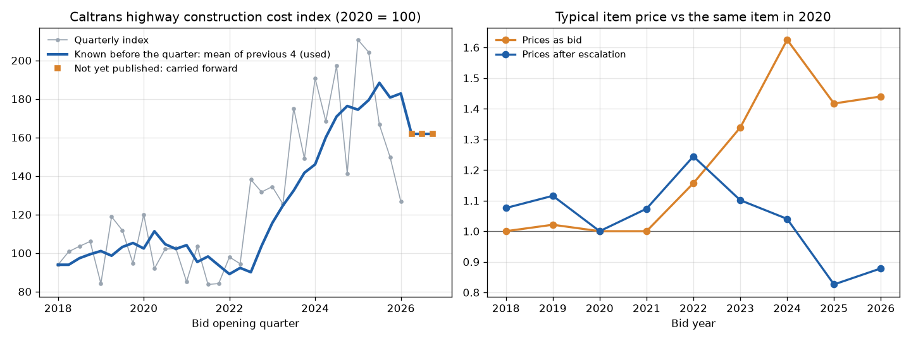

# 09 Price escalation

Bringing old bid prices to today's dollars with Caltrans' own cost index (step 2.2).

## The question

A price bid in 2019 is not a fair comparison for a bid in 2025: construction costs rose
sharply after 2021. Before comparing prices across years, each one is adjusted by how much
Caltrans' highway construction cost index moved between the two bid dates.

## Where the index comes from (decision D-039)

Caltrans publishes a quarterly California highway construction cost index (CHCCI, 2020 =
100). Its table sits on a Caltrans site that does not allow automated access, so it is not
downloaded. Instead, the index is recovered from the Caltrans cost database pages we had
already collected: every page shows each price both as bid and "adjusted to today's
dollars" with this index, along with today's index. The ratio between the two gives the
index for the quarter the bid opened. All 841 contracts
give the same value within each quarter (largest disagreement
0.0125%), so the recovered numbers are Caltrans' own.

## Which version of the index is used (decisions D-040, D-044)

The quarterly index jumps around (it rests on the few contracts bid each quarter), so
prices are adjusted with its **4-quarter average**, the same idea as Caltrans' own
12-month index. And because Caltrans works out each quarter's index from the bids opened
in that quarter, a bid is valued only with what was known before it opened: the average
of the four previous quarters. On 2022 and 2023 training bids, this removed the
under-pricing that inflation causes in a 12-month historical median (from 8% too low to
0.2% too low).

The last published quarter is 2026 Q1. Later quarters
(2026 Q2, 2026 Q3, 2026 Q4) are not published yet and use that quarter's value.

## Check: do escalated prices stay level?

For each item, its median low-bid price in a year is compared with its own 2020 median;
the table shows the typical ratio across items. As bid, prices rose about
44% from 2020 to 2026.
After escalation to the same date they should stay near 1.00.

| Bid year | Items | Prices as bid | After escalation |
| ---: | ---: | ---: | ---: |
| 2018 | 76 | 1.00 | 1.08 |
| 2019 | 76 | 1.02 | 1.12 |
| 2020 | 82 | 1.00 | 1.00 |
| 2021 | 81 | 1.00 | 1.07 |
| 2022 | 79 | 1.16 | 1.24 |
| 2023 | 78 | 1.34 | 1.10 |
| 2024 | 74 | 1.63 | 1.04 |
| 2025 | 80 | 1.42 | 0.83 |
| 2026 | 75 | 1.44 | 0.88 |

Escalation narrows the range of yearly price levels from
1.00–1.63 as bid to
0.83–1.24. It does not track every year:
the index follows a broad basket of Caltrans work, and items in this slice can move
against it (in this data, item prices dipped in 2025 while the index's 4-quarter average
was still rising). The pricing models in steps 2.3 to 2.5 also see the bid date, so they
can correct what the index misses.

## What is stored

- Database table `cost_index`: series `CHCCI_2020` (published quarterly values) and
  `CHCCI_2020_KNOWN` (the 4-quarter average as known before each quarter, carried forward).
- Database view `bid_escalated`: every bid (72,113 rows) with its unit price in
  2026 Q4 dollars (index 161.85). Models escalate to each bid's own date
  instead, through `bidlens.pricing.setup.escalate`.

## Files

- `cost_index.csv`: every quarter: the published index, the 4-quarter average, and how many
  contracts and prices it was recovered from.
- `price_level_check.csv`: the table above.
- `escalation_check.png`: the chart above.

## How it was produced

`uv run python -m bidlens.pricing.escalate` (code in `src/bidlens/pricing/escalate.py`),
from the raw cache in `data/raw/sv08data/results/`. Generated 2026-11-20.
